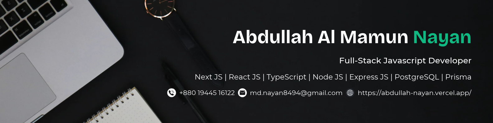

<h1 align="center">Hi 👋, I'm Abdullah Al Mamun Nayan</h1>
<h3 align="center">Full-Stack Developer</h3>

As a Full-Stack Developer, I focus on building modern, responsive, and user-friendly web applications from frontend to backend. With expertise in technologies such as React.js, Next.js, Node.js, and PostgreSQL, I develop scalable solutions that address real-world problems. From creating intuitive user interfaces to designing RESTful APIs and managing databases, I strive to write clean, maintainable code and build reliable applications. Explore my repositories to discover my projects, technical skills, and passion for creating meaningful digital experiences.

**Skills:** JavaScript, React.js, Next.js, Node.js, Express.js, HTML5, CSS3, Tailwind CSS, shadcn/ui, PostgreSQL, MongoDB, Prisma, Firebase, Git, and GitHub.

- 💡 I would like to explore new technologies and develop software solutions and quick hacks.

- 🌱 I’m currently learning **System design basics, VPS, Docker, NGINX**

- 👨‍💻 All of my projects are available at [https://abdullah-nayan.vercel.app/](https://abdullah-nayan.vercel.app/)

- 💬 Ask me about **JavaScript, TypeScript, React, Next JS, Tailwind CSS, Node JS, Express JS, MongoDB, MERN, PostgreSQL, Prisma ORM, HTML, CSS, Bootstrap**

- 📫 How to reach me **md.nayan8494@gmail.com**

- 📍 Location: Tongi, Gazipur-1710, Dhaka, Bangladesh

- 📄 Know about my experiences [https://drive.google.com/file/d/19DOY-30hpeCvbMKjrDiu0vHFs7Zf-2QU/view?usp=sharing](https://drive.google.com/file/d/19DOY-30hpeCvbMKjrDiu0vHFs7Zf-2QU/view?usp=sharing)

## <b> FOLLOW ME ON SOCIALS:</b>

##  <b> TECHNOLOGY STACK:</b>
### Languages:

### CSS Frameworks & Libraries:

### JavaScript Frameworks & Libraries:

### Database & Model:

### Deployment Platform:

### Design & Graphics:

### Tools & Technologies:

